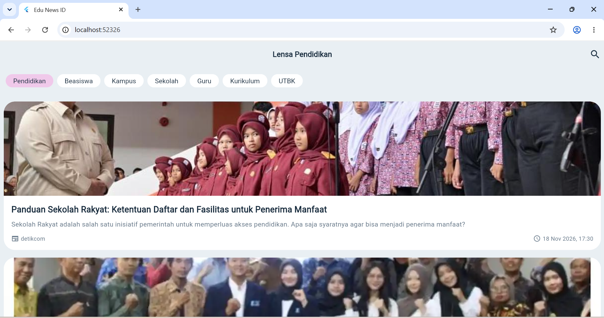
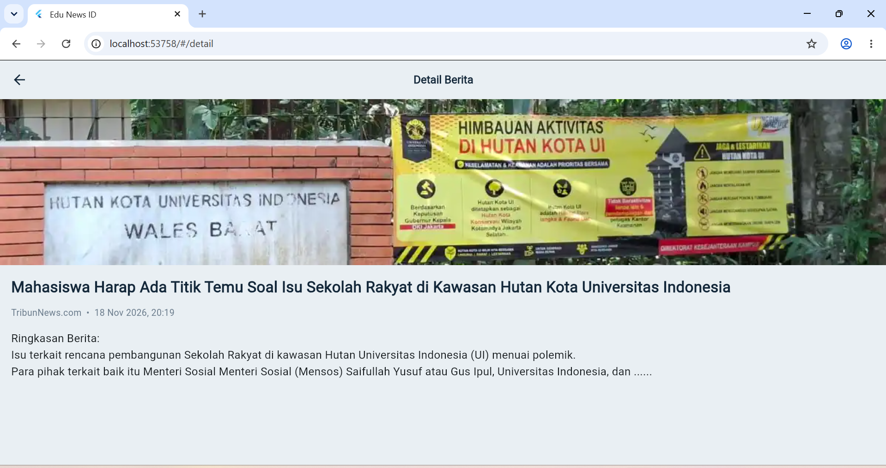
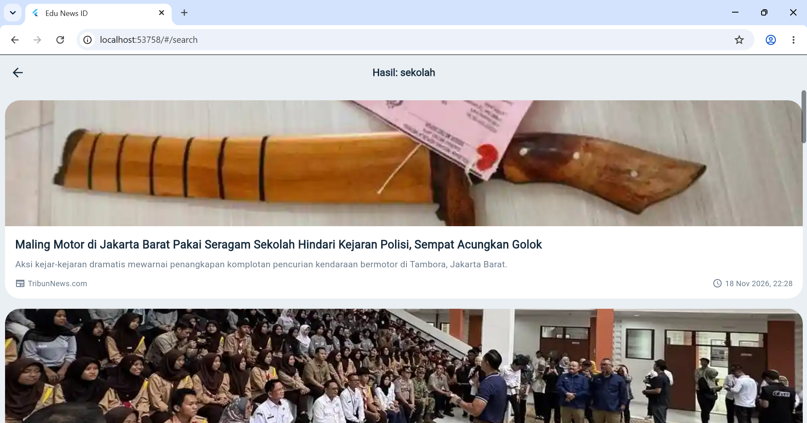
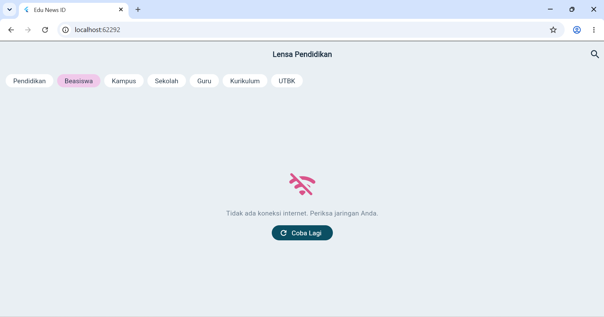
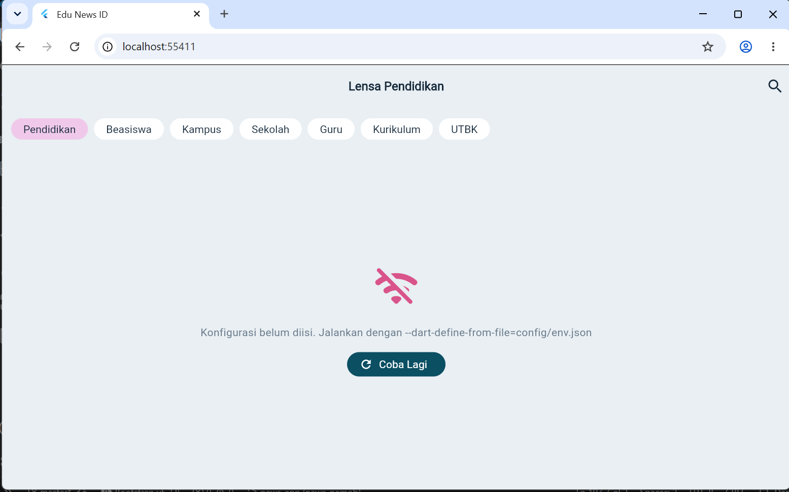

# Lensa Pendidikan

Aplikasi berita pendidikan Indonesia berbasis Flutter, memakai GNews API (endpoint `/search`).
Tugas Pemrograman Mobile: FutureBuilder, News App, dan Error Handling API.

## Fitur
- Daftar berita dengan FutureBuilder (4 state: loading, error, kosong, data)
- Pilihan topik (chip), halaman detail, pull-to-refresh
- Pencarian lewat dialog dan halaman hasil
- Cache per topik untuk hemat kuota
- `ApiException` dengan pesan error berbeda dan tombol Coba Lagi

## Cara Menjalankan
1. Salin `config/env.example.json` menjadi `config/env.json`, isi API key GNews.
2. Jalankan:
   ```bash
   flutter pub get
   flutter run -d chrome --dart-define-from-file=config/env.json
   ```

## Screenshot

### Beranda

### Detail Berita

### Pencarian Berita

### Error: tidak ada internet

### Error: konfigurasi kosong
